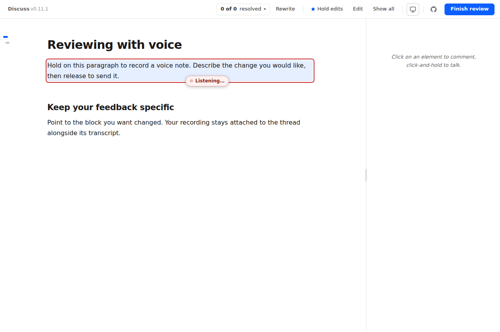
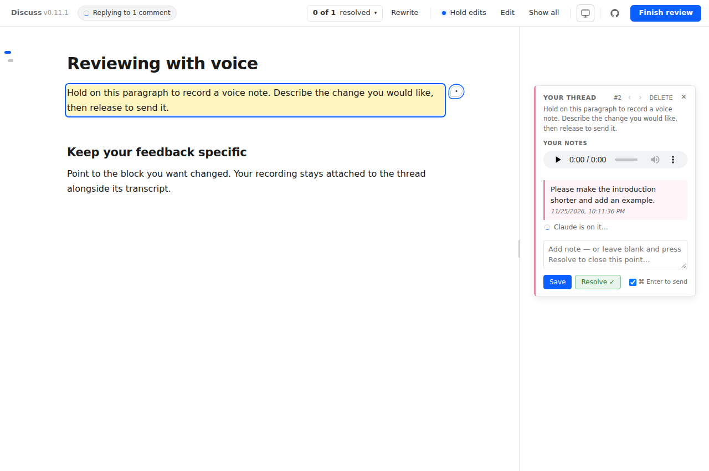

# Voice notes

Speak feedback on a document block instead of typing it. Discuss attaches the
recording and transcript to a new review thread.

**Voice is opt-in.** Configure a transcription command first; without one,
Discuss does not offer recording and rejects audio uploads. See
[configuration](config.md#voice-transcription) for the complete command contract.

## Record feedback

1. Configure a local transcriber using one of the prompts below, then restart
   Discuss so it loads the configuration.
2. Open a Markdown or diff review in a browser with microphone support.
3. Press and hold still on a block for about a quarter second, **or hover over
   the block and hold `V`**. Allow microphone access when prompted.
4. Wait for **Listening…**, then speak your feedback.
5. Release the pointer or `V` to submit. Press **Esc** to cancel instead.

Moving the pointer before recording begins preserves normal text selection.
Recording is not offered on image, HTML, or live website reviews.



After release, **Saving…** appears while the recording uploads and the local
command runs. The resulting thread contains a playable recording and transcript:



*These are screenshots of the actual UI captured with a synthetic browser
microphone and a fixed-output test command. They illustrate the workflow, not
speech-recognition accuracy or a tested engine installation.*

## Configure a transcriber

Discuss launches an executable with arguments, not a shell command string:

```toml
# ~/.discuss/discuss.config.toml (all projects)
transcription_command = ["/absolute/path/to/transcribe", "{filepath}"]
```

A project-local `discuss.config.toml` can override the user setting. The wrapper
must accept the saved audio path, print only UTF-8 transcript text to stdout,
and exit successfully. It should send progress messages to stderr. Discuss
substitutes `{filepath}` as a literal argument, safely preserving spaces.
Browser recordings may require conversion before an engine can read them.

The following prompts are intended for a coding agent with local shell access.
Copy **one entire prompt**. They deliberately ask the agent to consult current
upstream instructions rather than assuming CLI flags or model filenames.
Installation and model downloads can be large; review the plan before approving.

### Parakeet on Apple Silicon — parakeet-mlx

Upstream: [senstella/parakeet-mlx](https://github.com/senstella/parakeet-mlx).
Other Parakeet CLI implementations can also work through the same wrapper contract.

```text
Set up local voice transcription for Discuss using parakeet-mlx.
Use https://github.com/senstella/parakeet-mlx as the authoritative installation
and CLI reference. Inspect my OS and hardware first; verify Apple Silicon/MLX
compatibility and stop with alternatives if unsupported.

Before installing anything, show the dependencies, selected model, language
support, estimated download/disk requirements, and proposed changes for approval.
Use an isolated environment, not global Python package changes. Download the
required model from the upstream-recommended source after approval.

Create a wrapper in my user bin directory that accepts one audio filepath,
handles spaces safely, converts browser WebM/Opus or other input using ffmpeg
when necessary, runs the installed Parakeet CLI, and prints only the transcript
to stdout. Adapt file-output CLI behavior by reading the resulting text file.
Use a unique temporary directory per invocation and clean it up. Send diagnostics
to stderr and propagate failures. Do not use eval or upload recordings externally.

Back up and merge my ~/.discuss/discuss.config.toml without changing unrelated
settings. Set transcription_command to an argument array containing the absolute
wrapper path and "{filepath}". Check whether a project config overrides it.
Test with a short spoken audio sample I approve, including a filepath containing
spaces; verify nonempty UTF-8 stdout and successful exit within 120 seconds.
Do not claim success using a fixed-output stub. Show the final config and tell me
to restart Discuss and test hold-to-talk. If setup fails, leave voice disabled.
```

### Whisper on Apple Silicon — mlx-whisper

Upstream: [MLX Whisper](https://github.com/ml-explore/mlx-examples/tree/main/whisper).

```text
Set up Discuss voice notes using mlx-whisper. Consult
https://github.com/ml-explore/mlx-examples/tree/main/whisper for current setup,
model sources, and CLI usage. Inspect my OS/hardware and verify MLX compatibility.
Ask which languages I need. Present the model choice, download size, dependencies,
and installation plan for approval before downloading or installing.

Install in an isolated environment. Create a wrapper at an absolute user-owned
path that takes one audio filepath, supports browser WebM/Opus (converting with
ffmpeg if needed), invokes mlx-whisper, and emits only the transcript as UTF-8
stdout. If the CLI writes files, read its text output; keep logs on stderr.
Quote paths safely, use per-call temporary files with cleanup, propagate errors,
and keep transcription local. Do not change unrelated packages or settings.

Back up and merge ~/.discuss/discuss.config.toml, setting transcription_command
= ["/absolute/path/to/wrapper", "{filepath}"]. Check project config precedence.
Verify the real engine with an approved spoken sample whose path includes spaces;
check exit status, transcript output, and the 120-second Discuss timeout. Do not
enable a broken configuration. Report exactly what was tested and how to restart
Discuss and record a voice note.
```

### Cross-platform local option — whisper.cpp

Upstream: [ggml-org/whisper.cpp](https://github.com/ggml-org/whisper.cpp).

```text
Set up Discuss voice transcription using whisper.cpp. Read current instructions
at https://github.com/ggml-org/whisper.cpp and inspect my OS, CPU, available GPU,
and existing build tools. Propose a supported installation method and a model
appropriate for my hardware and languages. Ask approval before installing tools
or downloading models, explaining download/disk sizes and expected tradeoffs.

Create a native wrapper suitable for my platform that accepts one audio filepath,
converts browser audio to the format required by the installed whisper-cli using
ffmpeg, invokes the real engine, and prints only UTF-8 transcript text to stdout.
Use the installed CLI's documented options rather than guessing. Keep diagnostics
on stderr, handle spaces in paths without shell injection, clean up unique temp
files, propagate failures, and do not send audio to remote services.

Preserve unrelated config and make a backup before adding transcription_command
as an executable-and-arguments array to ~/.discuss/discuss.config.toml. Use an
absolute executable path and a literal "{filepath}" argument; if a script needs
an interpreter, include that interpreter explicitly in the array. Check for
project overrides. Test a real approved speech sample with spaces in its path,
including conversion and stdout capture, and verify completion within 120 seconds.
Leave voice disabled if verification fails. Show the final config and explain
restart, microphone permission, hold-to-talk, and Esc to cancel.
```

## Troubleshooting and privacy

- **No recording hint / `V` does nothing:** configure a nonempty executable,
  restart Discuss, check project overrides, and use a supported browser and file
  type. An empty command array (`transcription_command = []`) disables recording.
- **Mic blocked:** allow microphone permission for the current Discuss URL in
  your browser. Discuss sessions normally use a new port each time.
- **Audio appears but no transcript:** a missing executable, failed conversion,
  nonzero exit, empty/non-UTF-8 stdout, or the 120-second timeout triggers an
  audio-only fallback. Check Discuss logs and run the wrapper manually with a
  test recording. The agent still receives the audio path.
- **First transcription is slow:** pre-download and warm up the model when
  configuring the engine; choose a smaller model if needed.
- **Privacy:** Discuss stores recordings in a process-specific temporary folder.
  Commands run with your user permissions. Only use trusted configuration and
  wrappers; local transcription does not prevent a custom command or agent from
  sending audio elsewhere. Native-audio models need harness support to attach
  the recording—a filesystem path alone is not model audio input.
